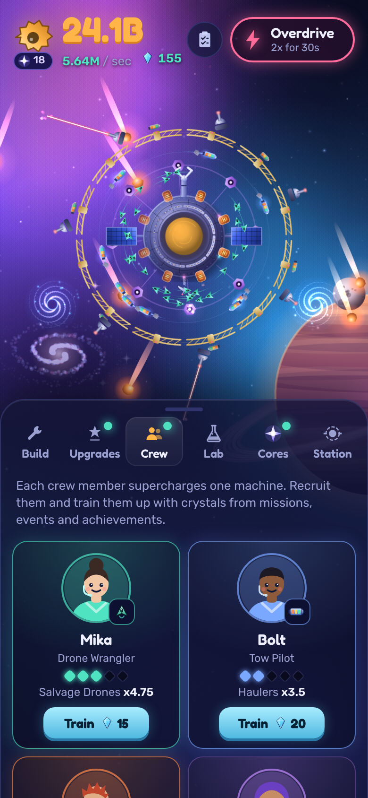

# Scrap Orbit

A cozy space-salvage idle clicker for phones and the web. Tap your station's claw to salvage scrap, build drones, haulers, smelters, fabricators and orbital docks that salvage for you, and watch the station grow as you go.



It runs in the browser at [scrap-orbit.web.app](https://scrap-orbit.web.app) and as an Android app. The art, sounds and music are all made in code.

## What's in the game so far

- Hand-painted space scene: nebula, spiral galaxy, ringed gas giant with an orbiting moon, comets, and soft out-of-focus rocks drifting past the camera
- Tap the station to earn scrap: the claw yanks in debris, with glowing sparks, a shockwave and floating numbers
- 10 machine tiers, each visibly added to the scene: drones, haulers, smelters, fabricators, a dock ring, mining lasers that shoot passing rocks, gravity wells, a nanite swarm, a warp gate and a Dyson swarm around a distant star. The camera pulls back as the station grows
- Buy x1, x10, x100 or Max
- Milestones at 10, 25, 50, 100, ... owned that double a machine's output
- A Salvage Claw levelled with scrap (+1 per tap per level, doubling every 10 levels)
- 116 upgrades: tap power, per-tier multipliers, global multipliers, taps that scale with income, and a long tail of 2x upgrades for every machine
- Relocation (prestige): jump to a new sector for Star Cores, +10% income each, with a warp-and-flash transition. Nine sectors cycle, each with its own sky, nebula, planet and music, announced by a title card; most bend one rule, and the last three have a rig you can only build there
- 6 core perks unlocked by how many cores you hold, including an Auto-Builder
- 22 achievements, each worth +1% income
- Crew: 10 collectible crew members with their own portraits, each one multiplying a machine's output, levelled up with crystals
- Living crew: everyone you recruit (and Mika from day one) walks the station deck as a little character. They stroll round the reactor, fix things with a wrench, stop for a chat, spacewalk out on a tether, fish off the edge once the fish tank is out, and cheer when a boss wreck shows up. At night they head inside through the hatch to sleep while one stays up on watch with a lantern. Tap one and they hop, wave and say something in their own voice; now and then they pipe up on their own. Crew away on expeditions leave through the hatch and come back the same way
- Missions: three daily goals and a weekly challenge that pay out crystals
- Timed events: meteor showers (tap the meteors), solar flares (supercharged taps) and trade convoys (tap the ship for crystals), every 12 to 20 minutes. Events, bosses, golden crates, the trader and cargo pods never overlap, and each is followed by at least 4 minutes of calm
- Research lab: a 16-project tree in four branches that runs on real time, even while the game is closed
- Decorations: six sky themes and five hull paints
- Boss wrecks: the first after 15 minutes of play, then one every 35 to 55 minutes, announced by a hazard-striped warning, an alarm and a red screen pulse. A giant derelict drifts in with a health bar; break it with taps (the claw fires a bolt) and machine fire within 60 seconds or it flies away. The payout is fixed when it arrives (5 minutes of scrap per second) plus crystals
- Boss loot: each broken wreck has a 20% chance (guaranteed after four dry runs) to drop a rare part with a permanent bonus or a pet skin
- Golden scrap: every 12 to 20 minutes a glittering golden crate drifts past; tap it for a 30-second golden rush where everything earns 7x
- Trading post: every 30 to 45 minutes a trader docks for 4 minutes with three one-off deals (crystals for scrap, scrap for crystals, a missing blueprint, an express recall for expeditions, or a missing wreck part)
- Challenge runs: from 5 Star Cores, start a fresh run under a rule (no taps, no upgrades, no crew, 3x prices); salvage the goal in one run for a permanent bonus, or give up and carry on. Goals grow with the cube of your station's power (cores, research, achievements, rooms and loot), so a challenge stays about an hour of play however strong the station is; the goal is fixed when you start
- Galaxy traits and constellations: from the second galaxy on, each galaxy bends one rule your way (cheaper machines, hotter taps, a long night that pays 3x for time away, doubled crew, treasure crates, twin suns), and two new Star Map nodes come into view in each galaxy up to the seventh
- Galaxy Shift (Prestige, Galaxy): once a run has built a Dyson Collector, trade every Star Core for Galaxy Stars and start over in a new galaxy. Each star ever earned adds 25% income, and stars buy permanent Star Map upgrades (a starter kit, stronger and more plentiful cores, perks that survive the shift, 5x taps, 2x offline, 2x mission crystals, 3x everything) plus a Star Forge that doubles everything each level. Every galaxy asks for more cores per star, and each one gets its own colour in the sky
- Feel: bought machines fly from their card into the station, big one-off gains lift a gold "+X" off the counter, and the bottom tabs hop when picked
- Locked cargo: every 25 to 40 minutes a wreck's cargo pod drifts by for 2 minutes. Crack its safe by tapping the dial when the needle sweeps through the green; three locks, each faster, and three misses jams it. Every lock opened pays scrap and crystals
- Collection book (Station, Book): seven sets to fill (boss wrecks, sectors, machines, safes, pets, wreck parts and crew). Each finished set pays crystals and unlocks a station skin
- Station skins (Station, Decor): seven looks that recolour the hull, reactor, beacons and machines
- A fuller welcome-back screen: besides offline earnings it lists finished research, crew back from trips, a trader on the way, golden scrap nearby, a boss that drifted off and your offline bonuses
- Expeditions: send recruited crew on 15-minute to 8-hour trips for crystals, scrap and module blueprints (their machine loses their bonus while they are away)
- Station rooms: build modules on a 3x3 grid with crystals (reactor, hangars, solar arrays and blueprint rooms); layout matters, since the reactor powers its neighbours and rooms like hangars, corners or the centre get extra. Rooms survive relocation and refund in full when taken down
- Pets: a Nebula Cat that pounces for free taps, an Orbit Pup that finds more and richer crates, a Star Owl for offline earnings and a Goo Blob that chews bosses. One follows the station at a time
- Daily login streak: a 7-day reward track of crystals, scrap and a free pet on day 7
- Generative music made in code: every sector has its own theme (a warm bass in Ember Reach, a music box in the Ice Belt, a slow wobble at the Black Hole Edge), boss wrecks bring a tense one, and it all slows into a lullaby at night. Three number formats and a full stats screen (collection and adventure records too)
- Menu square: a small square in the bottom corner opens the menu edge to edge across the bottom half of the screen, with five tabs along its top (Build, Crew, Lab, Prestige, Station). The square moves to the end of the tab row; tap it again to hide the menu and see the whole station. Build holds Machines and Upgrades, Prestige holds Star Cores, Challenges, the Galaxy and the Fleet, and each tab reopens where you left it
- Next goal: a line under the scrap counter always names one thing to work towards (a new machine, a milestone, an upgrade, or the next Star Core) with a progress bar. It holds on to that goal until it is done, and tapping it opens the right tab, scrolls to the machine or upgrade that finishes it and makes it glow
- Buy best: a button at the top of Machines buys whatever pays for itself soonest, counting both the wait to afford it and how fast its extra income earns back its price. It weighs single machines, buying up to the next milestone, and upgrades, and saves for a brand-new machine once it pays off nearly as soon as the best buy, so every new tier arrives on time. Hold it to keep buying
- Pan the view: drag the station to look around a little. It stretches past the edge and glides back to the middle when you let go, the scenery moves less than the station for depth. Taps still count the moment you touch, and press-and-hold still opens a machine
- Station decorations: twelve lights, plants, posters and silly extras (string lights, a hanging fern, paper lanterns, a neon sign, a disco ball, a rubber duck in orbit and more) that sit on the station itself. Each one is earned by playing, goes up straight away, and can be taken down or put back from Station, Decor. They stay through relocations
- Celebrations: the first time you ever build a machine, finish a collection set or relocate, a card pops up with confetti, fireworks around the station and a fanfare. Reduce flashing turns the confetti off and calms the card and the fireworks
- On the station: press and hold any machine to open its sheet and build more right there; tap the docked trader's ship for its deals
- Settings (gear button): separate effects and music volume, plus comfort options: three text sizes, colour-blind friendly colours (blue for go and orange for danger, with striped targets in the minigames), a left-handed layout that moves the round buttons, Overdrive and the menu square to the left, and switches to reduce flashing and screen shake. A privacy policy page is linked at the foot
- Info sheets: tap a machine's icon for its story, output, share of income and every multiplier; tap the income line for a full breakdown of where scrap comes from
- Scene life: smelters vent heat, fabricators weld, and far-off ships cross the sky with blinking nav lights
- A hands-on first-run tutorial with Mika, the drone wrangler: every step waits for the player to do it, with a spotlight and progress bar, plus one-time tips as the crew, lab and relocation unlock
- Captain ranks for new players: nine ranks from Deckhand to Captain, each with three small tasks that walk through the game in the order it opens up (crew, the Lab, fishing, boss wrecks, rooms, relocating, coming back on another day). A tracker at the foot of the station names the next thing to do; each promotion pays crystals and scrap, adds 2% income for good, and the ladder gives a pet cat and the Captain's Gold paint along the way. Fishing opens with the second rank, and the cloud-save invite waits until 15 minutes of play
- Overdrive: 2x everything for 30 seconds, every 5 minutes, with warp-speed stars
- Synthesized sound effects: FM bells and mallets, filtered noise for impacts and whooshes, a shared space echo and a compressor (each tap is one soft, steady note), with volume sliders
- Asteroids, meteors and moons painted per pixel from a height map: lumpy outlines, crater bowls with raised rims, lit from the same direction as the station
- Lucky salvage crates drift past every couple of minutes. Each is sealed until you tap it: most hold scrap, the rest hold a Power surge (5x income for 45s), a Claw frenzy (20x taps for 12s), a big haul that grows with your banked scrap, a swarm of little crates to catch, a crystal stash or a spare battery that recharges Overdrive. Buffs stack with Overdrive and golden rushes
- Autosave every 30 seconds and when the app is hidden
- Offline earnings for up to 8 hours (up to 24 with perks and research), shown when you come back
- Combo tapping: quick taps heat the claw up, and heat makes every tap worth up to 3x. A thermometer on the left shows it; at full heat the sparks run hot and a chime plays. Stop tapping and it cools
- Run contracts: from the second relocation on, pick one of three rule cards for the new run (Haulers 4x, taps 10x, machines 40% cheaper, a 20 minute sprint, and more), or none. Each sets a goal sized from the run before; meeting it pays 15 crystals and +2% income for good. A slim line at the top of Build tracks it
- The Hollow Fleet: a story told over the station radio. A garbled signal turns into a lost fleet's logs, a little girl's message in the ice and a captain asking for help. Thirteen transmissions in five chapters follow the beacon across sectors and galaxies, until the Lantern docks beside your station for good (+50% income) and the credits roll. Every transmission can be replayed from the Radio button
- Frost Festival: every year from 1 December to 6 January snow drifts past the station, the music turns cosy and salvage crates come gift-wrapped. Crates, boss wrecks and a daily present give snowflakes for the festival shop: hot cocoa (2x income for 30 minutes), a snowman and a Star Tree for the station, a Hoarfrost hull paint and crystal stockings
- Rebuild the Hollow Fleet: the endgame that opens once the Lantern docks. Captain Vey opens a drydock beside the station, and eight Hollow Fleet ships wait to be rebuilt one at a time with hull plates (from boss wrecks, relocations, galaxy shifts and the fleet's own patrols). Each ship takes real hours in the drydock, then joins a fleet that circles the station with a lasting ability (crates, income, time away, Star Cores, boss damage, crew, machine prices, Galaxy Stars), and can be refitted up to rank 5. Nothing about the fleet resets
- Dock visitors: now and then a shuttle docks and someone steps aboard with a favour: a comet scholar, a botanist, a retired mining robot, a courier grandma, a racer, a lighthouse keeper, a junk collector and the Hollow Fleet's last pilot. Each request has two answers that pay different rewards; one is the answer they hoped for and wins a heart. At three hearts they become a friend of the station and leave a keepsake that lasts forever. The guestbook (Profile, Collections) remembers what each of them likes
- Hydroponics garden (Station, Garden): plant crops in two plots (a third after two relocations, a fourth after a Galaxy Shift). They grow in real time, from 5-minute Star Sprouts to 8-hour Void Truffles, and harvesting one cooks a snack for the crew: a timed boost to income, taps, crates or boss damage. New crops unlock as you harvest more
- Salvage dives: a 30-second arcade minigame from the Dive button (after the first relocation). Slide the claw to catch falling scrap, gold and crystals and dodge the mines; three lives. Points pay seconds of income, and dives refill over time
- Space fishing: a calm minigame from the Fishing button (opens with the second captain rank). Cast into the nebula, hook the bite, then reel by tapping while the marker is in the green. 20 critters in four rarities (deeper sectors hold stranger ones) fill a catch book and swim in a tank beside the station. Catches pay scrap, first catches pay crystals and a legendary sets off a power surge. Bait refills over time
- Stardrifter, a cosmic whale to raise: about 20 minutes in, a salvage crate holds a warm egg that floats beside the station and hatches an hour later (sooner if warmed). Name the hatchling, then feed it scrap whenever it is hungry (up to three meals, one more every two hours); the crew also save it treats from catches, harvests and broken wrecks. Over a few days it grows from Hatchling to Calf, Juvenile, Adult and Elder, swimming round the station and then gliding huge behind it. It adds up to 50% income (more when it is happy, less when it is left hungry), gulps passing wrecks for minutes of scrap from the Calf stage, and sings a memory at every stage that slowly reveals what the scrap field really is. Fully grown, it can tow the station to the Nursery for +50% income for good, where little whales circle the station
- A living planet: about 45 minutes in, the scanners find a dead grey world hanging beside the station. Send salvage pods down to bring it back to life, one project at a time (most pods cost minutes of income, a few cost crystals); each project takes real time to take hold once its last pod lands. Over a week or two it goes from Dead world to the Thaw, Oceans, the Bloom, Life, Settlers and a Thriving world, drawn as a real turning globe that changes each era, with town lights on its night side at the end. At the Oceans you pick what grows first (coral seas for offline earnings, great forests for tap power, crystal dunes for boss damage and golden scrap). Every project adds 3% income, each era tells a short story, and a thriving world sends trade shuttles up with minutes of scrap
- Cloud save: sign in with Google to back up the station and play it on the web or another phone. Opening the game checks the cloud first, so an older device never overwrites newer progress. Delete my cloud save (Settings) removes the cloud copy, the friend profile and any gifts, and signs out

## Running it

Requires Node.js 20 or newer.

```sh
npm install
npm run dev          # local dev server; open the printed URL on your phone (same Wi-Fi)
npm test             # economy and pacing tests
npm run build        # production web build in dist/
npm run build:single # the whole game as one HTML file in dist-single/
```

## How it's built

- **TypeScript** with **Vite**
- **PixiJS** draws the station scene (`src/scene/`)
- Plain **HTML/CSS** for the HUD and menus (`src/ui/`, `src/style.css`)
- **break_infinity.js** for numbers far past what a normal float can hold
- Game rules live in `src/core/` with no rendering code, so they can be unit tested and simulated
- `src/core/pacing.test.ts` simulates an attentive player for 90 minutes and fails if the waits between purchases get too long

Tuning numbers (costs, outputs, upgrades, boost) are all in `src/core/config.ts`.

## Roadmap

1. **Prototype** (this): is the loop fun for 15 minutes?
2. **Vertical slice** (in progress): 10 tiers, the first prestige layer, achievements, final art style, sound
3. **Content and polish**: second prestige layer, challenges, cloud save
4. **Soft launch** on iOS and Android via Capacitor
5. **Global launch**

## License

MIT
