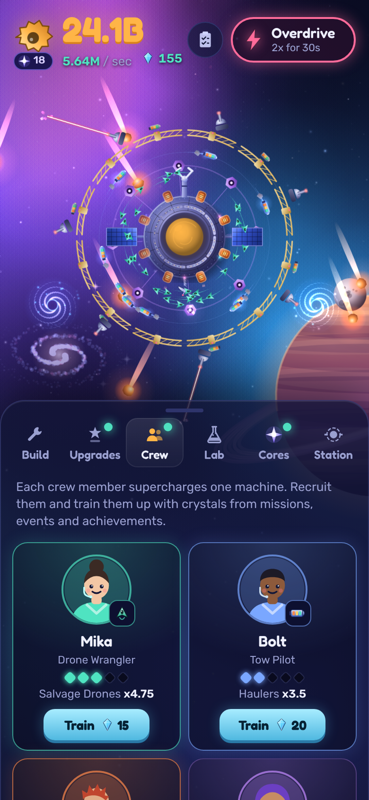

# Scrap Orbit

A cozy space-salvage idle clicker for phones and the web. Tap your station's claw to salvage scrap, build drones, haulers, smelters, fabricators and orbital docks that salvage for you, and watch the station grow as you go.



This is the **prototype**: the core loop with placeholder-quality art, built to find out whether the game is fun before the real art goes in.

## What's in the game so far

- Hand-painted space scene: nebula, spiral galaxy, ringed gas giant with an orbiting moon, comets, and soft out-of-focus rocks drifting past the camera
- Tap the station to earn scrap: the claw yanks in debris, with glowing sparks, a shockwave and floating numbers
- 10 machine tiers, each visibly added to the scene: drones, haulers, smelters, fabricators, a dock ring, mining lasers that shoot passing rocks, gravity wells, a nanite swarm, a warp gate and a Dyson swarm around a distant star. The camera pulls back as the station grows
- Buy x1, x10, x100 or Max
- Milestones at 10, 25, 50, 100, ... owned that double a machine's output
- A Salvage Claw levelled with scrap (+1 per tap per level, doubling every 10 levels)
- 29 upgrades: tap power, per-tier multipliers, global multipliers, and taps that scale with income
- Relocation (prestige): jump to a new sector for Star Cores, +10% income each, with a warp-and-flash transition. Six sectors cycle, each with its own sky, nebula and planet, announced by a title card
- 6 core perks unlocked by how many cores you hold, including an Auto-Builder
- 27 achievements, each worth +1% income
- Crew: 10 collectible crew members with their own portraits, each one multiplying a machine's output, levelled up with crystals
- Missions: three daily goals and a weekly challenge that pay out crystals
- Timed events: meteor showers (tap the meteors), solar flares (supercharged taps) and trade convoys (tap the ship for crystals)
- Research lab: a 16-project tree in four branches that runs on real time, even while the game is closed
- Decorations: six sky themes and five hull paints
- Boss wrecks: the first after 12 minutes of play, then one every 25 to 40 minutes, announced by a hazard-striped warning, an alarm and a red screen pulse. A giant derelict drifts in with a health bar; break it with taps (the claw fires a bolt) and machine fire within 60 seconds or it flies away. The payout is fixed when it arrives (5 minutes of scrap per second) plus crystals
- Boss loot: each broken wreck has a 20% chance (guaranteed after four dry runs) to drop a rare part with a permanent bonus or a pet skin
- Golden scrap: every 5 to 10 minutes a glittering golden crate drifts past; tap it for a 30-second golden rush where everything earns 7x
- Expeditions: send recruited crew on 15-minute to 8-hour trips for crystals, scrap and module blueprints (their machine loses their bonus while they are away)
- Station rooms: build modules on a 3x3 grid with crystals (reactor, hangars, solar arrays and blueprint rooms); layout matters, since the reactor powers its neighbours and rooms like hangars, corners or the centre get extra. Rooms survive relocation and refund in full when taken down
- Pets: a Nebula Cat that pounces for free taps, an Orbit Pup that finds more and richer crates, a Star Owl for offline earnings and a Goo Blob that chews bosses. One follows the station at a time
- Daily login streak: a 7-day reward track of crystals, scrap and a free pet on day 7
- Ambient generative music, three number formats and a full stats screen (collection and adventure records too)
- One-tap panel: a dock of tabs sits at the bottom; tap a tab to open its card (tinted in that tab's colour) and tap the same tab again to hide it. No dragging, no extra buttons
- Info sheets: tap a machine's icon for its story, output, share of income and every multiplier; tap the income line for a full breakdown of where scrap comes from
- Scene life: smelters vent heat, fabricators weld, and far-off ships cross the sky with blinking nav lights
- A hands-on first-run tutorial with Mika, the drone wrangler: every step waits for the player to do it, with a spotlight and progress bar, plus one-time tips as the crew, lab and relocation unlock
- Overdrive: 2x everything for 30 seconds, every 5 minutes, with warp-speed stars
- Synthesized sound effects: FM bells and mallets, filtered noise for impacts and whooshes, a shared space echo and a compressor (taps climb a musical scale), with a mute button
- Asteroids, meteors and moons painted per pixel from a height map: lumpy outlines, crater bowls with raised rims, lit from the same direction as the station
- Salvage crates that drift past now and then; tap one for a bonus
- Autosave every 30 seconds and when the app is hidden
- Offline earnings for up to 2 hours (4 with a perk), shown when you come back

## Running it

Requires Node.js 20 or newer.

```sh
npm install
npm run dev          # local dev server; open the printed URL on your phone (same Wi-Fi)
npm test             # economy and pacing tests
npm run build        # production web build in dist/
npm run build:single # the whole game as one HTML file in dist-single/
```

## How it's built

- **TypeScript** with **Vite**
- **PixiJS** draws the station scene (`src/scene/`)
- Plain **HTML/CSS** for the HUD and menus (`src/ui/`, `src/style.css`)
- **break_infinity.js** for numbers far past what a normal float can hold
- Game rules live in `src/core/` with no rendering code, so they can be unit tested and simulated
- `src/core/pacing.test.ts` simulates an attentive player for 90 minutes and fails if the waits between purchases get too long

Tuning numbers (costs, outputs, upgrades, boost) are all in `src/core/config.ts`.

## Roadmap

1. **Prototype** (this): is the loop fun for 15 minutes?
2. **Vertical slice** (in progress): 10 tiers, the first prestige layer, achievements, final art style, sound
3. **Content and polish**: second prestige layer, challenges, cloud save
4. **Soft launch** on iOS and Android via Capacitor
5. **Global launch**

## License

MIT
